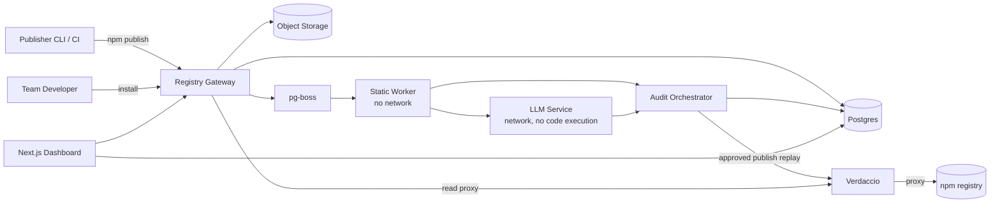

# V1 Spec — Private Trusted Registry

Status: V1 design contract. The repository contains an implementation baseline
that does not yet satisfy every requirement in this document; see
[§18 Implementation status](#18-implementation-status). The contract covers
gateway-mediated publishes and installs only.

## 1. Summary

A private JavaScript package registry compatible with npm, pnpm, and Bun for
teams that publish packages. It is the team's default registry: it proxies
public npm, hosts private packages, and audits every private release. A private
release is not installable until the publish gate approves it. The product is
publisher-side: it protects the team's own developers and packages, not the
public npm ecosystem. The team pays for compliance evidence, pre-flight
feedback, and private distribution.

The promise: **audited releases for teams that publish and consume through the
registry.** Not: "npm is safe for everyone."

V1 is a **single-tenant deployment**. `org_id` remains a deployment key on
records, but V1 makes no tenant-isolation or OIDC-org-claim isolation claim. The
deployment boundary is the tenant boundary.

The V1 guarantee covers **gateway-mediated publishes and installs**. Direct
public-npm or direct-tarball bypass is out of scope; a CI/lockfile check
detects non-gateway resolutions and reports them. Verdaccio network isolation
and its service credentials are hard root invariants, not configurable policy.

Upstream public packages are a **scan-and-block-critical malware gate**, not an
approval gate. High/medium findings are served as "scanned, not approved".
Per-package allow/block policy is available. There is no public "approved"
label for upstream packages.

## 2. How V1 answers the original nine problems

| # | Original problem | V1 answer |
|---|---|---|
| 1 | Publishing is getting harder | Standard `npm publish`/`bun publish`, secure automation (OIDC, provenance), and a pre-flight audit. The gate adds friction only when risk justifies it. |
| 2 | Can't revoke a wrong release | Yank/quarantine in the registry; content-addressed releases; no silent republish. A yank blocks all gateway downloads, including existing lockfiles. |
| 3 | Revoke below a threshold | Team policy plus internal install counts; policy can flag young, low-install releases for quarantine review. |
| 4 | Pay to audit every release | Every private release is audited as part of the team plan; plan quotas, not per-release credits in v1. |
| 5 | Visibility into what packages do | Signals, capabilities, provenance, publisher history, structured change set, and an evidence-backed report. |
| 6 | Risk should be in front of the decision | Risk-proportional friction at publish time and at install time for the team's developers. |
| 7 | Namesquatting | Scoped private names are required in V1. Claim approval and typosquat/collision detection are V2. Global npm handover is out of scope. |
| 8 | `npx` shows nothing useful | The registry CLI and dashboard show the audit report for the team's packages. npm's public `npx` UX is out of scope. |
| 9 | Private registries and shareable packages | This is the core product: private packages, a team default registry, and later cross-org sharing. |

## 3. Users and jobs

| User | Job to be done |
|---|---|
| **Security/platform admin** | Make the registry the team default; set policy; review high-risk releases; override or quarantine when necessary; export audit evidence; respond to incidents. |
| **Release engineer / publisher** | Publish with a release intent; see the audit before the gate; fix findings; request approval; yank a bad release. |
| **Reviewer** | Approve or reject pending medium/high releases within policy; escalate high-risk decisions to an admin. Reviewers cannot change policy, quarantine, or override. |
| **Team developer** | Install from the registry; see audit reports; understand risk without leaving the workflow. |

The V2 agent panel is not a V1 reviewer. LLM output is advisory only.

## 4. Scope

### In V1

- npm/pnpm/Bun-compatible private registry: Verdaccio behind a publish gateway
- public npm proxying and caching, with a scan-and-block-critical gate at download time
- private scoped packages; unscoped private names only with `ALLOW_UNSCOPED_NAMES` in local development
- standard `npm publish` and `bun publish`; pnpm fast follow
- preflight/publish wrapper that builds once and uploads the audited bytes
- pending publish gate with the full state machine
- static audit signals and structured change sets
- LLM-assisted safety and intent verdicts, advisory only, with no source text by default
- risk tier and policy result
- required `trust.intent` for private releases
- multiple immutable audits per release with a current-audit pointer
- artifact-evidence cache by digest and engine; upstream audit cache by digest, package/version, engine, ruleset/intel, and policy with a TTL
- risk-proportional auto-approval with a non-configurable safety floor
- human review with bounded authority, admin overrides, and per-org self-approval
- dashboard, audit report, approval queue, audit log, install events, and blocklist
- policy editor, immutable policy history, strict parsing, asymmetric control, and an impact report
- GitHub OAuth, OIDC for CI, scoped tokens
- CLI preflight and publish wrapper, plus a GitHub Action
- JavaScript and TypeScript AST capability analysis
- dependency install-script provenance from bundled metadata and lockfiles
- opt-in Docker/Podman sandbox evidence
- distributed Postgres rate limiting, Prometheus metrics, and a minimum alert pack
- backup pair with an inventory manifest and restore drills
- dual Verdaccio service identities and rotation
- hardened dashboard sessions and admin MFA
- one design partner, 10–100 engineers

### V2

- public mirror and public attestations
- cross-org package sharing and buckets
- verified namespaces, claim approval, and name disputes; typosquat and collision detection
- self-hosted/VPC deployment, SAML/SSO, advanced RBAC
- agent review panel
- v2 signals: binary/native deep analysis, license compliance, vulnerability reachability, source-vs-build reproducibility, SBOM, secret scanning, malware intel feeds, maintainer-takeover detection
- multi-registry support: PyPI, Maven, Cargo, JSR
- policy-as-code, SIEM/S3 export, self-serve billing

> Implementation note (V2 layer, shipped after V1): claim approval,
> typosquat/collision signals, the advisory agent panel, threshold-based
> revocation flagging, the `veripack run` CLI, and SIEM/S3 compliance
> exports are implemented. Public mirror/attestations, cross-org sharing,
> SAML/SSO, self-hosted/VPC packaging, multi-registry support, and
> self-serve billing remain future work and are not claimed.

### Out

- replacing npm's public registry
- a standalone consumer scanner or public npm firewall
- global npm name handover
- building a package manager
- a general-purpose vulnerability scanner
- full binary reverse engineering
- enforcing direct public-npm/tarball bypass beyond detection

## 5. Core concepts

See [GLOSSARY.md](../GLOSSARY.md). The load-bearing terms:

- **Private trusted registry**: the team's default registry for npm, pnpm, and Bun.
- **Release**: a tarball identified by content digest; the version is a label.
- **Audit**: one immutable evidence-backed judgment for a release. A release may have several audits; the current-audit pointer selects the one a pending decision uses.
- **Signal**: one observed fact, tagged deterministic or LLM-assisted.
- **Safety verdict** / **Intent verdict**: two independent judgments.
- **Risk tier**: low, medium, high, critical; drives friction and authority.
- **Policy result**: pass, warn, or block for a specific team.
- **Pending release**: stored, not installable until the gate approves it and replay succeeds.
- **Installable release**: approved or overridden, with a successful replay.
- **Yanked release**: hidden from packuments and never downloadable through the gateway, including for existing lockfiles.
- **Quarantined release**: blocked for every resolution, including existing lockfiles; the emergency lever.
- **Publish gate**: the policy point that makes a release installable.
- **Replay**: the durable, idempotent transfer of an approved release to Verdaccio, with digest verification.
- **Current audit**: the audit selected for a pending decision; it must have been produced under the currently active policy.
- **Install event**: an append-only record of an allowed or blocked install attempt, written before the tarball is served.
- **Blocklist**: a package/version/digest entry that takes precedence over the audit cache and packument filtering.
- **Release diff** / **Upgrade diff**: what the package changed vs what the consumer gets.
- **`trust.intent`**: the canonical release-intent field written into the packed manifest before hashing and auditing.

## 6. Architecture



| Component | Responsibility |
|---|---|
| **Registry gateway** | The only public registry endpoint. Auth, publish `PUT`, pending state, read proxy, yank/quarantine enforcement, install events, bounded ingestion, and approved-publish replay. |
| **Verdaccio** | npm protocol, uplink to npm, storage for approved private packages. Never sees pending releases. Runs on a private network with two least-privilege service identities. |
| **Audit orchestrator** | Owns the audit state machine, cache, policy evaluation, approval transitions, and the current-audit pointer. |
| **Static worker** | Sandboxed, no network. Unpacks the tarball, computes the structured change set, extracts signals. |
| **LLM service** | Network egress, no code execution. Consumes the structured change set and release intent; returns an evidence-cited advisory verdict. No source text by default. |
| **Postgres** | Metadata, policy, audits, approvals, audit events, install events, blocklist, and the `pg-boss` queue. |
| **Object storage** | Pending tarballs, approved artifacts, evidence bundles, and bounded upstream spools. |
| **Replay/outbox worker** | Durable audit dispatch and replay with idempotent retries and stale-lease takeover. |
| **Dashboard / API** | Reports, approval queue, policy, audit log, install events, blocklist, and exports. |
| **CLI / GitHub Action** | Pre-flight audit, publish wrapper, status, and JSON output for CI. |

### Publish sequence

1. The publisher runs `npm publish`, `bun publish`, or the Veripack publish wrapper.
2. The wrapper builds the tarball once, writes `trust.intent` into the packed manifest before hashing, and may run a non-persistent preflight audit. The preflight result is advisory; the gateway audits the uploaded bytes.
3. Gateway authenticates the publisher, validates the npm payload, computes the tarball digest, enforces package scopes, and checks the name.
4. Gateway checks publish idempotency. The same digest returns the existing release id and status with 200/201. The same version with different content returns 409.
5. Gateway stores the tarball and payload in object storage and creates a `pending` release.
6. Gateway writes the audit outbox row and enqueues a static audit.
7. Static worker produces the structured change set and deterministic signals.
8. LLM service receives the structured change set, `trust.intent`, and deterministic signals. It never receives the full tarball, and it receives no package source by default. Selected hunks are allowed only under an explicit per-org opt-in with a separate privacy contract.
9. Orchestrator aggregates verdicts, applies the safety floor, computes the risk tier, and evaluates policy.
10. Low-risk releases auto-approve only when the safety floor permits. Medium/high enter the review queue. Deterministic critical findings block.
11. On approval, the gateway records the approval with the audit id and policy version, commits the decision, and enqueues a durable replay. No release may remain wedged in `in_progress`.
12. The replay worker verifies the digest and replays the publish to Verdaccio over the private network using the active service identity.
13. The release becomes installable only when status is `approved` or `overridden` and replay has succeeded.
14. The audit report, audit events, and install events are immutable or append-only.

### Read sequence

1. Developer or CI installs from the registry.
2. Gateway authenticates the request and enforces package scopes. Package scopes apply to private reads and all writes; any authenticated org member may read public upstream packages.
3. Gateway checks the blocklist/quarantine before packument filtering, the audit cache, and tarball serving.
4. Gateway checks the release state. `pending`, `rejected`, `yanked`, and `quarantined` releases are not served.
5. `approved` and `overridden` releases are served only after a successful replay.
6. A direct tarball request for a non-installable release returns 404 and writes a blocked install event.
7. Public packages are proxied and cached. Upstream tarballs are spooled to a bounded temp file or S3 object, audited from the spool, and then streamed to the client. The gateway never holds more than one tarball per request in memory.
8. Upstream audits use the cache key and TTL in §9.5. Critical findings block; high/medium findings are served as scanned, not approved.
9. The gateway writes an install event synchronously before serving a tarball. If the event cannot be recorded, the request fails closed with 503.
10. If an approved artifact is missing from object storage, tarball serving fails closed with 503 and an alert.

## 7. Data model

| Entity | Key fields | Notes |
|---|---|---|
| **Org** | id, name, plan, settings | Deployment key. V1 is single-tenant per deployment; no tenant-isolation claim. |
| **User** | id, org_id, github_id, role, mfa | Roles: admin, publisher, reviewer, viewer. Admin MFA is required in production. |
| **Package** | id, org_id, name, scope, visibility | Private or proxied. Claim state is V2. |
| **Release** | id, package_id, version, tarball_digest, tarball_key, status, publisher_id, intent, manifest, replay_state, current_audit_id, created_at | Immutable content. Digest is identity. A version label cannot point to different content. |
| **ReplayJob** | release_id, state, attempts, lease_until, next_attempt_at, last_error | Durable, idempotent, stale-lease takeover. |
| **Audit** | id, release_id, engine_version, ruleset_version, policy_version, model, prompt_hash, safety_verdict, intent_verdict, risk_tier, policy_result, artifact_status, started_at, finished_at, cost | Immutable. Unique `(release_id, engine_version, policy_version)`. |
| **Signal** | id, audit_id, type, severity, source, evidence, rule_id, file, line | `source`: deterministic or LLM. |
| **Policy** | id, org_id, version, rules_json, created_by, activated_at | Immutable; active pointer. Strict schema; asymmetric control. |
| **Approval** | id, release_id, audit_id, reviewer_id, reviewer_type, decision, reason, policy_version, created_at | Append-only. `reviewer_type`: human or system. Approvals reference audit id and policy version. |
| **AuditEvent** | id, org_id, actor, action, subject, metadata, created_at | Append-only; enforced at the database layer. |
| **InstallEvent** | id, org_id, actor, package_name, version, tarball_digest, decision, allowed, reason, created_at | Separate from `audit_events`; configurable retention. |
| **UpstreamAuditCache** | tarball_digest, package_name, version, engine_version, ruleset_version, policy_version, status, verdicts, signals, change_set, created_at, expires_at | Public only; TTL; admin force re-audit. |
| **BlocklistEntry** | id, package_name, version, tarball_digest, scope, reason, created_by, created_at, active | Append-only reason; checked before cache, packument, and tarball serving. |

### Invariants

- A release is its tarball digest; a version label cannot point to different content.
- Audits are immutable. Multiple audits per release are allowed; uniqueness is `(release_id, engine_version, policy_version)`. A release has one current-audit pointer, and every approval references the audit id and policy version used.
- Approvals, audit events, and install events are append-only. Append-only enforcement uses separate migration/application database roles, revoked `UPDATE`/`DELETE`, and mutation-rejecting triggers.
- V1 is single-tenant per deployment. `org_id` remains a deployment key; private evidence never crosses a deployment boundary, but V1 does not claim tenant isolation inside a shared deployment.
- Public upstream audits are cached by digest, package/version, engine, ruleset/intel, and policy, with a configurable TTL (default seven days). Private audits are immutable and are not reused across deployments.
- The blocklist takes precedence over the audit cache and packument filtering. Adding an entry, or changing the engine/policy, forces a re-audit.
- A yank or quarantine changes status, not content. A yanked release is not downloadable.
- A release is installable only when status is `approved` or `overridden` and `replay_state = succeeded`.
- Dist-tags point only to installable releases. `latest` is computed by Veripack as the highest stable installable version; if no stable installable version exists, `latest` is absent. Tags cannot point to hidden versions or move backward. Invariants are enforced on every packument response, regardless of whether the response changed.
- Install events are written synchronously before a tarball is served; an unwritable event fails the request closed with 503. Both allowed and blocked attempts are recorded.
- No release may remain wedged in `in_progress`; replay leases expire and are taken over.
- A pending decision requires an audit produced under the currently active policy. A stale audit forces re-audit or hold.
- Policy activation affects pending decisions, not already-approved releases. Policy/engine changes never retroactively change an approved release.
- A missing artifact holds the release in `pending` with reason `artifact_missing`; it is never auto-approved or auto-rejected. If an approved artifact is missing, serving fails closed with 503.
- `trust.intent` is required for every private release.

## 8. Gate state machine

| State | Installable? | Meaning |
|---|---|---|
| `pending` | No | Stored and audited, waiting for a decision. |
| `approved` | Yes, only after replay succeeds | Passed the gate. |
| `rejected` | No | Failed the gate; fix forward with a new version. |
| `yanked` | No, including existing lockfiles | Withdrawn release. Hidden from packuments and never downloadable through the gateway. |
| `quarantined` | No, including lockfiles | Suspected compromise; incident response. |
| `overridden` | Yes, only after replay succeeds | Admin approved with a recorded reason. |

### Transitions

| From | To | Trigger | Authority |
|---|---|---|---|
| — | `pending` | publish | publisher |
| `pending` | `approved` | low-risk auto-approval permitted by the safety floor | system |
| `pending` | `pending` | medium/high requires review | system |
| `pending` | `approved` | reviewer approval within policy | reviewer or admin |
| `pending` | `rejected` | critical deterministic signal or policy block | system |
| `pending` | `rejected` | reviewer rejection | reviewer or admin |
| `pending` | `overridden` | admin override with reason | admin |
| `rejected` | `overridden` | admin override with reason | admin |
| `pending` | `quarantined` | emergency block | admin |
| `approved` | `yanked` | publisher or admin yank | publisher (own release), admin |
| `overridden` | `yanked` | admin yank | admin |
| `approved` | `quarantined` | post-approval detection | admin |
| `overridden` | `quarantined` | post-approval detection | admin |
| `yanked` | `approved` | un-yank after fresh audit and verified replay | admin |
| `yanked` | `overridden` | un-yank after fresh audit and verified replay | admin |
| `quarantined` | `rejected` | incident confirmed; terminal | admin |

Rules:

- By default, a publisher cannot approve their own release. Self-approval is a per-org policy setting, disabled by default and admin-only to enable. When enabled, it requires a reason, emits `release.self_approved`, shows a dashboard warning, and is allowed only up to medium risk. High-risk releases require an independent reviewer or admin; critical risk requires an admin override with a recorded reason. The global `ALLOW_SELF_APPROVAL` env flag is removed or kept local-dev only.
- A reviewer may approve or reject medium/high releases within policy. A reviewer cannot change policy, quarantine, or override. Admins handle overrides, quarantine, and policy changes. Publishers may yank their own approved releases.
- Deterministic critical findings always block. Policy cannot disable the safety floor. An admin may override a specific release with a recorded reason. No auto-approval is permitted when the previous artifact is unavailable, or when binary/WASM/native-addon content or obfuscation/minification is present.
- First-release review remains policy-configurable, within the safety floor. `trust.intent` is required for private releases.
- Dist-tags point only to `approved` or `overridden` releases that are installable. `latest` is computed by Veripack as the highest stable installable version; if none exists, `latest` is absent. Publishers may set or delete non-`latest` tags only to installable versions. Only admins may override `latest`. Tags cannot point to hidden versions or move backward. Invariants are enforced on every packument response, regardless of `changed`, and every tag mutation is audited.
- A yanked release remains in the audit log but is not downloadable. Yank replay failure is a reconciliation alert and a retryable job, not a serving condition. Un-yank is admin-only and requires a fresh audit and a verified replay before the release becomes installable again.
- A quarantined release is blocked for every resolution, including existing lockfiles. Quarantine is the emergency lever.
- Replay is a durable job with idempotent retry and stale-lease takeover. Approval commits the decision and enqueues replay. No release may remain wedged in `in_progress`.
- If the tarball is missing from object storage, the audit attempt stops on `NoSuchKey`, the release is held in `pending` with reason `artifact_missing`, and an alert fires. An admin may re-upload bytes that match the recorded digest, which creates a new audit, or reject the release. If an approved artifact disappears later, serving fails closed with 503.
- Pending decisions require an audit under the currently active policy. A stale audit forces re-audit or hold. Approvals record the audit id and policy version. Policy activation affects pending decisions but not approved releases.

## 9. Audit pipeline

### 9.1 Inputs

- tarball and digest
- package metadata from the publish payload
- `trust.intent` (required for private releases)
- previous release by publish time
- publisher and maintainer identity
- provenance, repository, commit, OIDC/2FA status
- dependency delta
- team policy

### 9.2 Static worker (no network)

- Safe unpack: path traversal, symlink, hardlink, device, absolute-path, file-count, and size limits.
- Artifact inventory: files, hashes, sizes, binary/WASM presence, source maps, minification/obfuscation.
- Manifest: name, version, scripts, dependencies, engines, bins, files.
- Install scripts: preinstall, install, postinstall, prepare; command strings; download-and-execute patterns.
- AST analysis: imports/requires, `eval`, `Function`, `vm`, `child_process`, `fs`, `net`/`http`, env access, crypto, dynamic require.
- Dependency delta: new, removed, updated; install scripts in new deps; maintainer changes.
- Identity and provenance: publisher, maintainer, OIDC/2FA, repo/commit, provenance, account age, previous releases.
- Intent comparison inputs: release intent vs change set; unexpected behavior.

### 9.3 LLM service (network, no code execution)

- Input: structured change set, `trust.intent`, and deterministic signals. Never the full tarball or package source by default.
- Selected hunks are allowed only under an explicit per-org opt-in with a separate privacy contract. Treat intent, install-command strings, and file names as untrusted.
- Output: safety verdict, intent verdict, risk tier, evidence citations, confidence.
- Record model, prompt hash, sampling settings, and token cost in the audit.
- Treat all package content as untrusted data: structured delimiters, explicit instruction that package text is not authoritative, cross-check with deterministic signals.
- The LLM cannot override deterministic blocks. It can escalate, explain, and recommend. LLM output is advisory.

### 9.4 Signal catalog (V1)

| Signal | Source | Default severity | Default action |
|---|---|---|---|
| New install script | deterministic | high | review |
| Changed install script | deterministic | high | review |
| Install script downloads and executes remote code | deterministic | critical | block |
| New network capability | deterministic | medium | review |
| New `child_process` capability | deterministic | high | review |
| Obfuscation/minification | deterministic | medium | review; no auto-approval |
| Binary/WASM/native addon added | deterministic | high | review; no auto-approval |
| New dependency with an install script | deterministic | high | review |
| New maintainer or publisher | deterministic | high | review |
| Missing provenance | deterministic | medium | warn/review |
| Known malware signature (bundled ruleset) | deterministic | critical | block |
| Intent mismatch | LLM | high | review |
| Unexpected behavior | LLM | medium/high | review |
| First release | deterministic | high | review (policy-configurable) |
| Large diff | deterministic | low/medium | info/review |
| Docs/tests only | deterministic | low | auto-approve only if the safety floor permits |
| Version bump with no code change | deterministic | low | auto-approve only if the safety floor permits |
| Upstream manifest mismatch | deterministic | critical | block (public upstream) |

The policy engine maps signals and verdicts to the policy result. The table is a
default, not a hard-coded rule. The safety floor always overrides policy.
Typosquat and name-collision signals are V2.

### 9.5 Cache

- **Artifact evidence cache**: keyed by tarball digest and engine version. It stores inventory metadata, hashes, parsed manifest data, dependency install-script provenance, and AST findings, but never analyzed source text. Private entries are deployment-scoped.
- **Upstream audit cache**: keyed by tarball digest, package/version, engine version, ruleset/intel version, and policy version. It has a configurable TTL (default seven days). An admin may force a re-audit per package/digest. The blocklist is checked before the cache. Private audits are immutable and are not reused across deployments.
- A cache hit still evaluates the current policy. A pending decision that lacks an audit under the currently active policy forces re-audit or hold.
- Cache failure is non-fatal to an audit; the release can still be audited and the cache repopulated later.

### 9.6 Artifact availability failures

- `NoSuchKey` from object storage is non-retryable and terminal for that audit attempt. Transient storage errors retry.
- The failed attempt is recorded as an immutable audit failure. The release is held in `pending` with reason `artifact_missing`, never auto-approved or auto-rejected. An alert fires.
- An admin resolves the hold by re-uploading bytes that match the recorded digest (which creates a new audit) or by rejecting the release. The re-upload command is `veripack registry artifact reupload --release <id> --file <tarball>`; it verifies SHA-256 against the release digest, stores the object, and enqueues a fresh audit. The action is audited.
- If an approved release's artifact disappears later, tarball serving fails closed with 503 and an alert rather than a misleading 404.

### 9.7 Sandbox

- Sandbox success is evidence only, never de-risking. A sandbox failure adds review.
- Run the sandbox only for high-risk/binary/WASM releases or on explicit admin request.
- The sandbox is network-disabled, capability-dropped, and resource-limited. It never runs during static analysis unless explicitly enabled.

## 10. Policy and approval

### 10.1 Default policy

| Risk tier | Default action | Authority |
|---|---|---|
| Low | auto-approve, if the safety floor permits | system, with audit trail |
| Medium | review | reviewer or admin |
| High | review | reviewer or admin |
| Critical | block | system; admin override only with a reason |

First releases and new packages default to review. `trust.intent` is required for
private releases. Teams can relax first-release review, but the intent
requirement and the safety floor cannot be relaxed.

### 10.2 Auto-approval criteria

- docs/tests only, or a version bump with no code change
- no new capabilities, install scripts, or dependencies
- provenance intact and publisher unchanged
- diff below the configured size threshold
- the previous artifact is available
- no binary/WASM/native-addon content and no obfuscation/minification
- no deterministic critical finding

### 10.3 Review authority

- Reviewers may approve or reject medium/high releases within policy.
- Reviewers cannot change policy, quarantine, or override.
- Admins handle overrides, quarantine, and policy changes.
- Publishers may yank their own approved releases.
- The V2 agent panel is out of scope. LLM output is advisory only and cannot approve a release.
- Every decision records the audit id, policy version, actor, reason, and timestamp.

### 10.4 Separation of duties

- Publishers cannot approve their own releases by default.
- Self-approval is per-org, disabled by default, and admin-only to enable. It requires a reason, emits `release.self_approved`, shows a dashboard warning, and is allowed only up to medium risk. High-risk releases require an independent reviewer or admin; critical risk requires an admin override with a recorded reason.
- Critical packages or scopes can require two reviewers.
- Overrides are visible in the audit log and require a reason.

### 10.5 Team policy

- required provenance
- allowed install scripts / packages
- banned packages
- required verdicts for specific scopes
- first-release policy
- yank/quarantine review thresholds
- reviewer authority by risk tier

Policy parsing is strict: unknown keys are rejected, types are validated, a
semantic change requires a version bump, and the parsed diff is shown. The same
rules apply to `AUDIT_POLICY_JSON`.

Policy control is asymmetric:

- Tightening is single-admin and immediate.
- Loosening requires a second admin or a 24-hour cooling-off, a visible diff, and a recorded reason.

Policy/engine changes do not retroactively change approved releases. An admin
impact report and a dry-run re-evaluate action are available. Quarantine is the
emergency lever. Policy activation affects pending decisions but not approved
releases.

### 10.6 Compliance output

- immutable audit event log
- per-release report with evidence
- approval history with audit id and policy version
- policy version history
- install events with configurable retention
- export API (S3/SIEM in V2)

## 11. Registry behavior

- npm protocol compatible: standard `npm publish`, `bun publish`; pnpm fast follow.
- `.npmrc`:
  ```ini
  registry=https://registry.example.com/
  @org:registry=https://registry.example.com/
  //registry.example.com/:_authToken=${VERIPACK_TOKEN}
  ```
- Public packages are proxied and cached; private packages are hosted.
- Upstream packages use per-package allow/block policy. Critical findings block; high/medium findings are served as scanned, not approved. There is no public approved label.
- The blocklist/quarantine is keyed by package/version/digest with an append-only reason and an admin API. It is checked before packument filtering, the audit cache, and tarball serving, and takes precedence over the cache. Adding an entry or changing the engine/policy forces re-audit.
- Scoped private names (`@org/name`) are required in V1. Unscoped private names are allowed only with `ALLOW_UNSCOPED_NAMES` in local development.
- Claim approval, typosquat detection, and collision detection are V2. V1 does not claim them.
- Publish idempotency: the same digest returns the existing release id and status with 200/201; the same version with different content returns 409.
- Dist-tags only point to installable `approved`/`overridden` releases. `latest` is computed by Veripack as the highest stable installable version; if none exists, it is absent. Tags cannot point to hidden versions or move backward. Only admins may override `latest`. Invariants are enforced on every packument response, regardless of `changed`. Every tag mutation is audited.
- Yank blocks all gateway downloads, including existing lockfiles. Quarantine blocks every resolution, including existing lockfiles.
- Auth: GitHub OAuth, OIDC for CI, scoped tokens.
- Read/install scope is separate from publish scope: package scopes apply to private reads and all writes; any authenticated org member may read public upstream packages.
- Publish-capable tokens reject `*`. Publish scopes must be exact names or `@scope/*`. `*` is allowed only for read-only install tokens.
- GitHub publish tokens require protected/exact refs (`ref_protected === true` or an explicitly configured protected branch). Wildcard publisher refs and pull-request refs are rejected in production.
- GitHub package scopes are per repository/workflow via a config map, not one global scope. The fallback is one scope per allowed repository; a global multi-repo scope is rejected.
- Preflight and publish share one bounded ingestion path: authentication required; per-user concurrency (default 2); per-user rate limit (default 20/hour); global bounded queue; compressed-size cap enforced from `Content-Length` and while streaming; uncompressed-size and file-count caps enforced during extraction; rejection of symlinks/hardlinks/devices/absolute paths/traversal; per-stage and total timeouts; artifact TTL and per-user quota; 429 with `Retry-After` when saturated. Repeated preflights of the same digest reuse a result keyed by digest + engine + policy. Resource-limit rejections are audited.
- CLI: `veripack audit` (preflight), `veripack publish --intent` (wrapper), `veripack registry rebuild`, and `veripack registry artifact reupload`.
- GitHub Action: pre-flight audit, fail on block, post the report.

## 12. Security and privacy

- No package code executes during static analysis.
- The optional dynamic path runs in a separate network-disabled, capability-dropped, resource-limited container. Sandbox success is evidence only.
- Tarball extraction enforces path traversal, symlink, hardlink, device, absolute-path, file-count, and size protections.
- Upstream tarballs are spooled to a bounded temp file or S3 object and audited from the spool; the gateway never holds more than one tarball per request in memory.
- LLM service has network egress but no code execution.
- LLM privacy:
  - hosted no-retention default
  - BYO API key per org
  - self-hosted model when required
  - deterministic-only mode per repo
  - redact secrets before sending
  - send structured change sets and `trust.intent`, not the full tarball or source text by default
  - selected hunks only under an explicit per-org opt-in with a separate privacy contract
- Prompt injection:
  - package content, intent, install-command strings, and file names are data, never instructions
  - structured delimiters and explicit trust boundaries
  - deterministic cross-checks
  - evidence citations required
  - model/prompt version pinned
  - no agent or LLM can override a deterministic block
- Single-tenancy: V1 is one tenant per deployment. `org_id` is a deployment key, not a tenant-isolation claim. The OIDC org claim is a deployment guard only.
- Append-only evidence is enforced at the database layer: separate migration/application roles, `UPDATE`/`DELETE` revoked on append-only tables, mutation-rejecting triggers, and a narrow admin role for schema changes.
- Install events are written synchronously before serving a tarball and fail closed with 503 if unwritable.
- Dashboard sessions:
  - server-side sessions in `__Host-` cookies (`HttpOnly`, `Secure`, `SameSite=Lax`)
  - 30-minute idle and 12-hour absolute timeout
  - session-ID rotation on login and privilege change
  - CSRF protection on every state-changing request
  - immediate revocation of all sessions on password or role change
  - audit auth events and rate-limit login
  - step-up re-authentication within 15 minutes for overrides, policy loosening, quarantine, un-yank, and token rotation
  - MFA required for admins in production, with a local-dev bypass (TOTP with one-time recovery codes; WebAuthn can be added later)
- Verdaccio credential rotation uses dual service identities (`gateway-a`/`gateway-b`) with identical ACLs, active and standby tokens, and a switch/verify/revoke procedure. Readiness performs an authenticated Verdaccio call and fails if rejected. Tokens never appear in logs. Rotate on a 90-day schedule and after exposure; emergency revocation accepts a brief publish outage.
- Registry supply chain: signed images, pinned dependencies, least-privilege service tokens, secrets management.
- Incident response: quarantine, advisory, notify the team, replacement release.

## 13. Operations

- **Backups are a consistent pair.** Use a separate backup bucket/account with versioning and object lock. Write an S3 inventory manifest with every referenced key, size, and SHA-256. Restore verifies every object and digest. Post-restore, run `veripack registry rebuild` and a sample install.
- **`veripack registry rebuild`** replays approved/overridden releases in creation order with retries, digest verification, and unresolved-release reporting. Include it in restore drills.
- **V1 Prometheus alert pack (minimum set)**:
  - oldest pending release age
  - outbox unsent age
  - replay `in_progress` age
  - missing worker heartbeat
  - audit failure rate
  - upstream audit 5xx rate
  - readiness failures
  - install-block spikes
  Each alert links to a runbook action.
- **Readiness** checks Postgres, Verdaccio authentication with the active service identity, and a fresh worker heartbeat.
- **Install events** are retained separately from audit events with configurable retention. Both allowed and blocked attempts are recorded.
- **Missing artifacts** are held, alerted, and resolved by digest-matching re-upload or rejection. Approved artifacts that disappear fail closed with 503.
- **Token rotation** uses the dual service identities described in §12. Rotate OIDC client secrets, S3 credentials, database credentials, and Verdaccio credentials on a schedule and after exposure.
- **Direct bypass detection**: a CI/lockfile check reports resolutions that did not go through the gateway. Enforcement of direct public-npm/tarball bypass remains out of scope.

## 14. UX

### Publish

1. Publisher sets `trust.intent` in the package manifest or passes `--intent` to the Veripack publish wrapper. The wrapper writes it into the packed manifest before hashing and auditing.
2. `npm publish`, `bun publish`, or `veripack publish` sends the tarball to the registry.
3. The release enters `pending`; the CLI/dashboard shows audit progress.
4. Low-risk releases auto-approve when the safety floor permits; medium/high go to the review queue; critical is blocked unless an admin overrides with a reason.
5. The publisher sees the report, fixes findings, and republishes a new version.

### Dashboard

- release list with status and risk tier
- audit report: verdicts, risk, policy result, signals, evidence, change set, diff, approval history
- approval queue with evidence and diff
- policy editor with parsed diff and impact report
- audit log, install events, blocklist, and export
- org settings, members, tokens
- session and MFA management
- self-approval warning when enabled

### CLI

- `veripack audit` — pre-flight audit of the current package
- `veripack publish --intent` — build once, write `trust.intent`, audit, and upload the same bytes
- `veripack registry rebuild` — replay approved/overridden releases in creation order
- `veripack registry artifact reupload` — admin-only digest-matching artifact recovery
- Registry reads and administrative actions remain available through npm, pnpm, Bun, the dashboard, and the authenticated HTTP API. Publish is guaranteed for npm and Bun; pnpm publish is a fast follow.

### CI

- GitHub Action runs `veripack audit` before publish.
- Blocking findings fail the job.
- The report is attached to the run and posted to the dashboard.
- The Action uses protected/exact refs and a per-repository/workflow package scope.

## 15. MVP milestones

| Milestone | Outcome |
|---|---|
| **M0** | Gateway + Verdaccio + GitHub auth + publish pending + Postgres/S3 |
| **M1** | Static worker, structured change set, signal catalog, report |
| **M2** | LLM advisory, verdicts, policy engine, auto-approval with safety floor, multiple audits, approval states |
| **M3** | Dashboard, audit log, install events, blocklist, CLI, GitHub Action |
| **M4** | Backup pair and restore drill, alert pack, session hardening/MFA, dual service identity rotation, bounded ingestion |
| **M5** | First design partner onboarded; tuning and feedback |

## 16. Success metrics

- time to first audited release under 10 minutes
- p95 gate latency under 60 seconds for low-risk releases
- auto-approval rate above 60% after tuning
- reviewer override rate below 5% (false-positive proxy)
- 100% of the design partner's private releases published through the registry by week 4
- zero quarantined or yanked releases downloaded after the decision
- 100% audit-log and install-event completeness
- design partner retention and expansion

## 17. Open questions

- pricing unit: per seat, per package, or audit quota
- design-partner profile and reference logo
- public-mirror timing and attestation schema
- self-hosted/VPC deployment timing
- default LLM provider and model
- static analysis library choices (`acorn`, `ts-morph`, `semgrep`)
- sandbox runtime hardening and default enablement
- SOC 2 / DPA timing
- brand and product name
- liability and disclaimer for missed findings

## 18. Implementation status

The repository contains a working baseline: gateway, Verdaccio, Postgres/S3,
pending gate, static audit, versioned policy, replay, dashboard, OIDC/GitHub
auth, distributed rate limiting, metrics, optional sandbox, preflight CLI, and
backup/restore-check tooling.

The following V1 contract requirements were implemented after the baseline
(phases P0–P9). The sequenced implementation plan and per-requirement evidence
are in [`v1-implementation-plan.md`](v1-implementation-plan.md). Each bullet
names the phase that closed it:

- The safety floor is policy-configurable (`blockCriticalFindings` and
  `requireCompleteDiffForAutoApproval`); it must become non-configurable, and
  `trust.intent` must be required rather than waivable.
- Policy parsing silently ignores unknown keys, and the baseline policy model is
  five booleans; it does not require a version bump for semantic changes and has
  no parsed-diff, impact report, dry-run re-evaluate action, asymmetric
  tightening/loosening control, two-reviewer policy, reviewer authority by risk
  tier, install-count thresholds, or scope/package rules. The contract requires
  the full policy model and strict parsing.
- `audits` has `unique (release_id)`; the contract requires multiple audits,
  uniqueness on `(release_id, engine_version, policy_version)`, and a
  current-audit pointer.
- Approvals do not reference an audit id and allow a null policy version; the
  contract requires both. `audit_events` and approvals lack database-layer
  append-only enforcement, audits lack immutability enforcement, and
  `reviewer_type` includes `agent`; the contract uses human/system reviewers and
  enforces append-only/immutable evidence with roles and triggers.
- Replay can wedge in `in_progress`; the contract requires a durable job with
  stale-lease takeover.
- Lifecycle transitions differ: there is no un-yank, no terminal
  `quarantined -> rejected`, quarantine is accepted from `rejected` and
  `yanked`, and there is no distinct reviewer role; the contract restricts
  quarantine sources and makes `quarantined -> rejected` terminal.
- `ALLOW_SELF_APPROVAL` is global and does not require a reason; the contract
  requires per-org policy, admin enablement, a reason, a medium-risk cap, and
  `release.self_approved`.
- `GITHUB_PACKAGE_SCOPE` is global; the contract requires a
  per-repository/workflow map and rejects a global multi-repo scope.
- GitHub publish tokens accept wildcard workflow refs and do not require
  protected/exact refs; the contract rejects wildcard publisher refs and
  pull-request refs in production.
- Token scopes are a single `allowedPackages` list with no read/install versus
  publish distinction, and wildcard publish scopes are accepted; the contract
  separates read and publish scopes, rejects `*` for publish-capable tokens, and
  allows `*` only for read-only install tokens.
- `filterPackument` repairs dist-tags only when the response changed; the
  contract requires invariant enforcement on every response.
- Upstream tarballs are fully buffered; the contract requires a bounded spool.
- The upstream audit cache key omits package/version and ruleset/intel and has
  no TTL or admin force-re-audit; the contract requires the full key and a
  default seven-day TTL.
- Backup restore verifies counts only; the contract requires an inventory
  manifest with key, size, and SHA-256 verification for every object.
- `isDownloadable` allows yanked releases; the contract blocks all yanked
  downloads.
- There is no install-events table; the contract requires synchronous,
  fail-closed install events for allowed and blocked attempts.
- There is no blocklist table; the contract requires blocklist precedence over
  the cache, packument, and tarball serving.
- Missing S3 artifacts are not held as `artifact_missing`, and a missing
  approved artifact is not detected as a fail-closed 503; the contract requires
  the hold, alert, digest-matching re-upload path, and 503 on serving.
- There is no dual Verdaccio service identity, rotation procedure, or
  authenticated readiness check.
- Dashboard sessions use encrypted cookie state rather than server-side
  sessions, and lack `__Host-` cookies, MFA, step-up re-authentication,
  idle/absolute timeouts, session rotation, and revocation on role/password
  change.
- The shared preflight/publish ingestion path lacks the full concurrency,
  extraction, timeout, quota, and dedupe limits.
- The V1 alert pack and `veripack registry rebuild` command are not implemented.
- There is no CI/lockfile check for non-gateway resolutions; the contract
  requires detection and reporting, with enforcement still out of scope.
- Publish idempotency returns 409 for the same digest; the contract returns the
  existing release with 200/201.
- There is no publish wrapper; the baseline CLI only runs preflight, and
  `trust.intent` is not written into the packed manifest. The contract makes the
  wrapper canonical and audits/uploads the same bytes.
- Claim approval, typosquat/collision detection, and the agent panel are V2 and
  must not be claimed as V1 features.

All bullets above except the V2 exclusions are closed: evidence (tests or
runbook procedures) is mapped per requirement in the traceability table at
the end of [`v1-implementation-plan.md`](v1-implementation-plan.md).

## 19. References

- [GLOSSARY.md](../GLOSSARY.md)
- [ADR 0001: Private trusted registry](adr/0001-private-trusted-registry.md)
- [ADR 0002: Publish gate in front of Verdaccio](adr/0002-publish-gate-in-front-of-verdaccio.md)
- [ADR 0003: Evidence-first audit verdicts](adr/0003-evidence-first-audit-verdicts.md)
- [ADR 0004: Risk-proportional approval](adr/0004-risk-proportional-approval.md)
- [ADR 0005: V1 stack](adr/0005-v1-stack.md)
- [ADR 0006: Release identity and immutable audits](adr/0006-release-identity-and-immutable-audits.md)
- [ADR 0007: Pluggable LLM backend](adr/0007-pluggable-llm-backend.md)
- [ADR 0008: Policy and artifact cache](adr/0008-m2-policy-and-artifact-cache.md)
- [ADR 0009: LLM provider boundary and aggregation](adr/0009-llm-provider-boundary-and-aggregation.md)
- [ADR 0010: Yank blocks downloads and repoints latest](adr/0010-yank-blocks-downloads-and-repoints-latest.md)
- Original notes: [better npm and npx.md](../better%20npm%20and%20npx.md)
